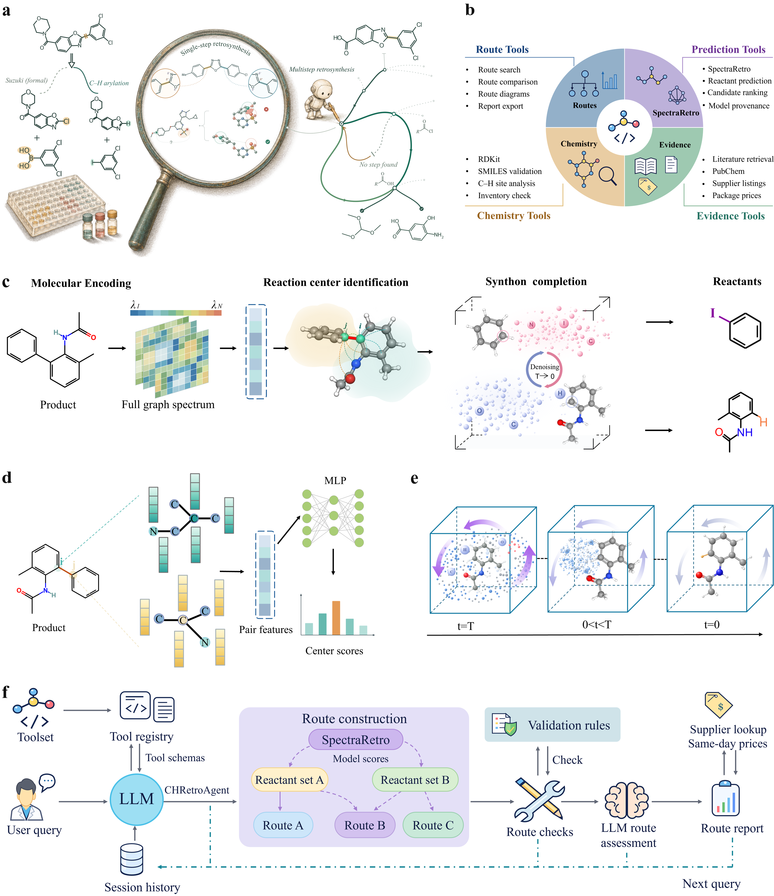

# SpectraRetro and CHRetroAgent

[中文说明](README.zh-CN.md)

SpectraRetro uses full-spectrum atom-pair learning to identify reaction centers in the product and chemical-prior-guided conditional 3D diffusion to reconstruct reactants from synthons. It ranks precursor candidates by a model score that incorporates their sampling frequency. CHRetroAgent uses these candidates to build multistep routes and a language model to assess alternative synthetic strategies.



## Download the complete repository

Install Git LFS to download the CHRetro data, trained weights and prediction records.

```bash
git lfs install
git clone https://github.com/jameslee980126-tech/SpectraRetro.git
cd SpectraRetro
git lfs pull
```

## Reproduce the single-step results

To recalculate precursor recovery and reaction-center accuracy from saved predictions, run these commands from the repository root with Python 3.10 or later.

```bash
python scripts/reproduce_results.py --check
python results/reaction_center/reproduce.py --check
```

To run the pretrained model on the 9,250 CHRetro test reactions, install the [model dependencies](docs/getting_started/installation.md) in a CUDA environment and choose the command for your reaction-class setting.

```bash
python src/spectraretro/unknown-class/run.py  # reaction class withheld
python src/spectraretro/known-class/run.py    # reaction class supplied
```

Append `--smoke` for a two-reaction example. Ranked precursor sets are written to `evaluation/ranked_candidates.jsonl` in the run directory. [Model code](src/spectraretro/) · [Data and splits](datasets/README.md) · [Weights](docs/guides/checkpoints.md) · [Evaluation protocol](docs/guides/evaluation.md).

## Explore the CHRetroAgent routes

Figure 5 shows the routes for lapatinib, nemiralisib and tafamidis. With RDKit installed, run the command below and open `outputs/lapatinib.html` to inspect the five-step lapatinib route. [All three cases](CHRetroAgent/README.md).

```bash
python CHRetroAgent/preview.py --report results/cases/agent/case_l/result.json --export outputs/lapatinib.html
```

[Figures and tables in the paper and SI](docs/paper_map.md) · [Training and reproduction commands](docs/guides/reproduction.md) · [Citation](CITATION.cff) · [License](LICENSE)
