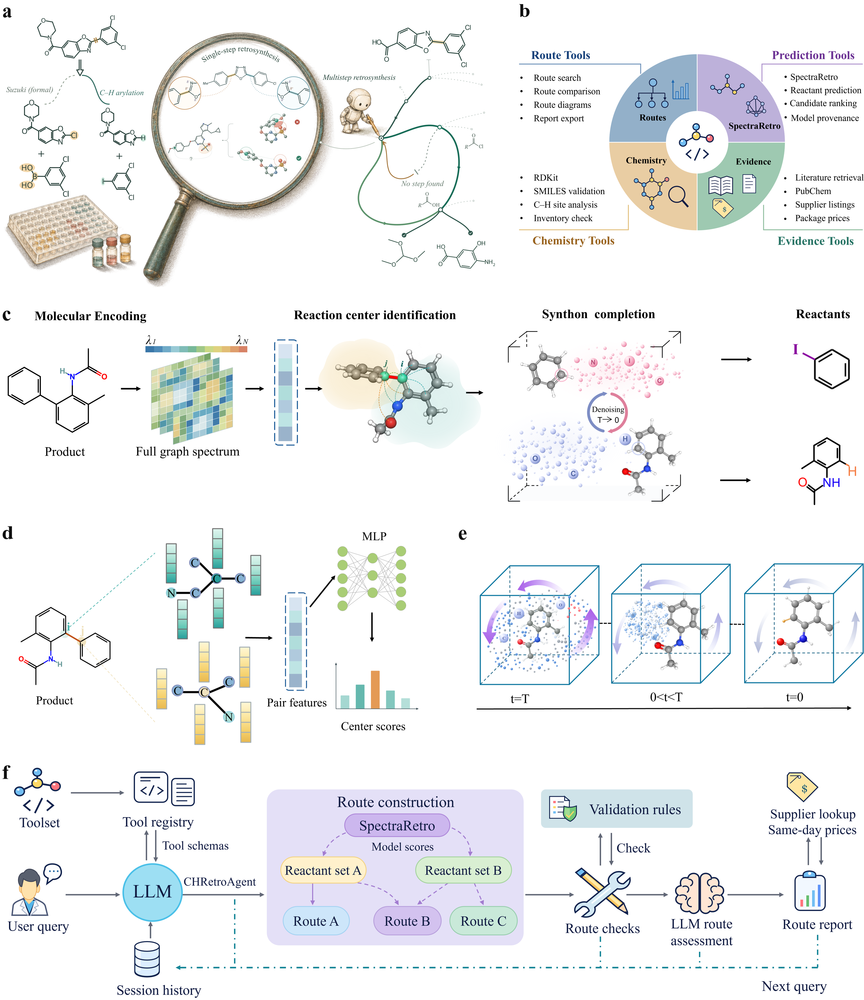

# SpectraRetro 与 CHRetroAgent

[English README](README.md)

SpectraRetro 通过全谱原子对学习在整个产物结构中识别反应中心，再通过化学先验引导的条件三维扩散从合成子重建反应物。模型结合候选出现频次，按模型得分确定前体候选的最终顺序。CHRetroAgent 利用这些候选构建多步路线，并借助语言模型评估备选路线的合成策略。



## 下载数据和权重

安装 Git LFS 后运行以下命令，获取 CHRetro 数据、训练权重和预测记录。

```bash
git lfs install
git clone https://github.com/jameslee980126-tech/SpectraRetro.git
cd SpectraRetro
git lfs pull
```

## 复现单步预测结果

使用 Python 3.10 或更高版本，在仓库根目录执行以下命令，即可从已保存的预测分别复算前体恢复和反应中心识别准确率。

```bash
python scripts/reproduce_results.py --check
python results/reaction_center/reproduce.py --check
```

如需在 9,250 条 CHRetro 测试反应上运行预训练模型，请在 CUDA 环境中安装[模型依赖](docs/getting_started/installation.md)，然后按反应类别是否已知选择一条命令。

```bash
python src/spectraretro/unknown-class/run.py  # 类别未知
python src/spectraretro/known-class/run.py    # 类别已知
```

在命令后加 `--smoke` 可用两条反应试跑。排序后的前体候选保存在运行目录的 `evaluation/ranked_candidates.jsonl`。[模型代码](src/spectraretro/) · [数据与划分](datasets/README.md) · [权重](docs/guides/checkpoints.md) · [评价方法](docs/guides/evaluation.md)。

## 查看 CHRetroAgent 多步路线

正文图 5 展示了拉帕替尼（lapatinib）、奈米拉利司（nemiralisib）和氯苯唑酸（tafamidis）的路线。安装 RDKit 后，运行以下命令，用浏览器打开 `outputs/lapatinib.html` 即可查看拉帕替尼的五步路线。[全部三个案例](CHRetroAgent/README.md)。

```bash
python CHRetroAgent/preview.py --report results/cases/agent/case_l/result.json --export outputs/lapatinib.html
```

[正文与 SI 图表](docs/paper_map.md) · [训练与复现命令](docs/guides/reproduction.md) · [引用信息](CITATION.cff) · [许可证](LICENSE)
